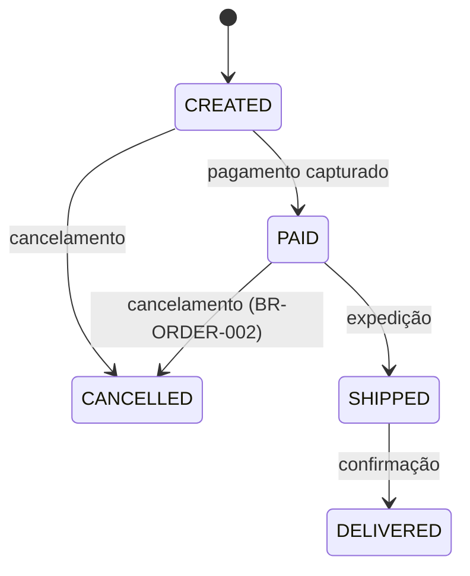

# STATES AND TRANSITIONS

## Order

Source: `OrderStatus.java`, `OrderService.java:120-160` · Confidence: INFERRED (transições só no código)

Transições proibidas conhecidas: `SHIPPED → CANCELLED` (exceção `IllegalStateException`, `OrderService.java:142`).
