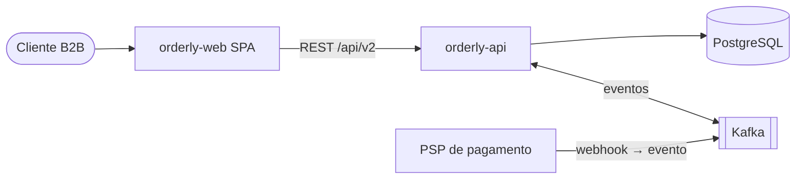
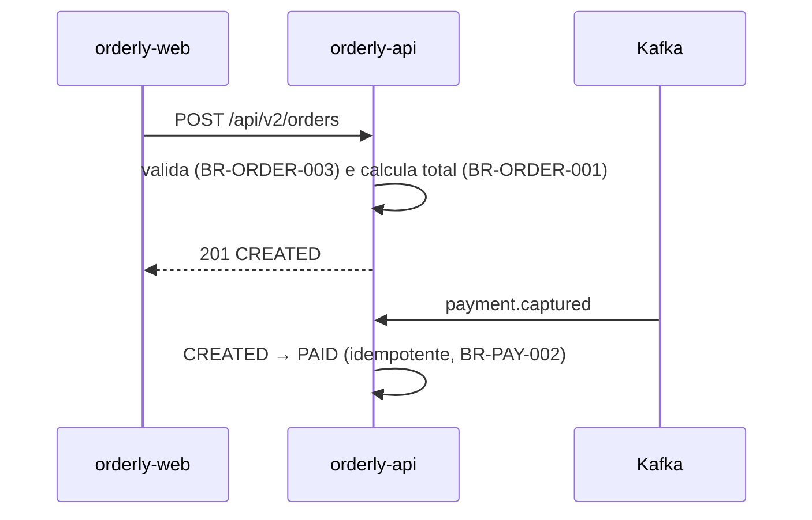

# SYSTEM ARCHITECTURE

## CURRENT_ARCHITECTURE

Monolito em camadas (controller → service → repository) no `orderly-api`, organizado por
pacote de domínio; SPA separada no `orderly-web` — Source: estrutura de pacotes, ADR-0002 — Confidence: CONFIRMED.
Onde o estilo é violado: `PaymentController` acessa `PaymentRepository` diretamente (GAP-ARCHITECTURE-001).

## MODULES

| Módulo | Responsabilidade | Depende de | Source |
|---|---|---|---|
| order | ciclo de vida do pedido | payment, customer | `src/main/java/.../order` |
| payment | captura, estorno, eventos do PSP | — | `src/main/java/.../payment` |
| customer | empresas e usuários | — | `src/main/java/.../customer` |

## BOUNDARIES

| Regra observada | Violações conhecidas | Source | Confidence |
|---|---|---|---|
| Controllers não acessam repositories | `PaymentController` | ADR-0002, código | CONFIRMED |

## DEPENDENCIES

| Dependência | Versão | Uso | Source |
|---|---|---|---|
| Spring Boot | 3.3.4 | framework | `pom.xml:15` |
| Flyway | 10.x | migrations | `pom.xml:61` |
| spring-kafka | 3.2 | eventos de pagamento | `pom.xml:70` |

## DATA_FLOW

## INTEGRATIONS

PSP de pagamento via webhook → tópico `payment.events`; e-mail transacional via SMTP. CONFIRMED (`application.yml`, consumer).

## SECURITY_BOUNDARIES

JWT emitido por Keycloak; autorização por `@PreAuthorize` nos controllers (BR-ORDER-004). Segredos via variáveis de ambiente injetadas pelo pipeline. CONFIRMED.

## DEPLOYMENT_MODEL

Imagens Docker publicadas por GitHub Actions; deploy em Kubernetes via Helm (`charts/orderly-api`, `values-prod.yaml`). Ver [ENVIRONMENTS](../06_OPERATIONS/ENVIRONMENTS.md).
